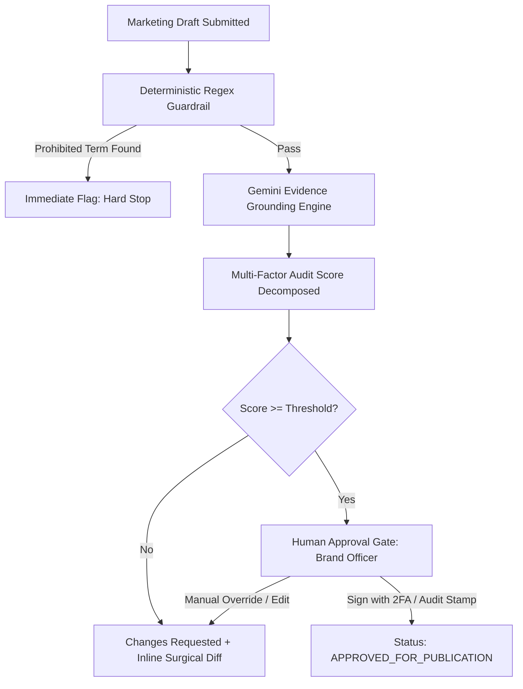

# INKLOOM AI — ENTERPRISE DESIGN GUIDELINES & SPECIFICATION SYSTEM
**Document ID:** `DSG-INK-2026-V1`  
**Standard:** Enterprise B2B SaaS High-Craft Specification  
**Inspiration & Lineage:** Linear Method, Vercel Geist, Raycast, Supabase Studio, Radix UI Primitives  
**Status:** Canonical & Mandatory Architecture  
**Target:** Inkloom AI Brand Governance & Compliance Platform

---

## 1. Executive Summary & Purpose

Inkloom AI operates at the intersection of regulatory compliance, enterprise brand reputation, and factual claim verification. For high-stakes legal, medical, and corporate brand teams, visual gimmicks destroy institutional trust. 

Previous iterations suffered from the pervasive malaise of **"AI Slop"**:
- Purple cosmic background blur orbs that look like marketing landing pages from 2023.
- Indiscriminate use of `Sparkles` (`✨`) icons on every button and card.
- Fuzzy translucent glassmorphism with bloated 24px padding and unreadable low-contrast text.
- Opaque single percentage scores ("98% AI Confidence") without verifiable mathematical breakdown.
- Soft, borderless floating cards with undefined visual boundaries.

This document establishes the **High-Craft Enterprise Standard** for Inkloom AI. Every screen, component, and interaction must convey deterministic rigor, tool-grade speed, typographic authority, and audit-grade provenance.

---

## 2. The Anti-AI-Slop Manifesto

```
  ┌───────────────────────────────────────────────────────────────────────────┐
  │                         ANTI-AI-SLOP MANIFESTO                            │
  │                                                                           │
  │  1. NO COSMIC GLOW ORBS         → Strict carbon depth & hairline borders  │
  │  2. NO SPARKLES AS CRUTCH       → Purpose-built glyphs (Shield, Check)    │
  │  3. NO FUZZY GLASSMORPHISM      → Solid, opaque, structured surfaces      │
  │  4. NO OPACITY-0.2 HEADINGS     → WCAG AAA contrast typography            │
  │  5. NO UNGROUNDED SCORES        → Multi-factor audit provenance           │
  │  6. NO PASSIVE "AUTO-APPLY"     → Surgical inline diffs with human gating │
  │  7. NO SQUISHY BORDER RADII     → Crisp 6px/8px radii, 1px precision cuts │
  │  8. NO MARKETING BUZZWORDS      → Deterministic, legal-grade vocabulary   │
  └───────────────────────────────────────────────────────────────────────────┘
```

### The 10 Commandments of Anti-AI-Slop

1. **Never use cosmic glow orbs, multi-color mesh gradients, or animated background halos.**  
   Gradients are reserved exclusively for subtle hairline borders (0.5px–1px linear gradient) or tiny active focus rings. The canvas is deep, dead carbon.
2. **Ban the ubiquitous `Sparkles` (`✨`) icon from all operational UI.**  
   AI in Inkloom is not "magic." It is an automated regulatory pre-flight engine, semantic vector search, and deterministic rule auditor. Use domain-accurate icons: `ShieldCheck`, `Scale`, `FileSearch`, `GitCompare`, `Fingerprint`, `CheckCheck`.
3. **No fuzzy, low-contrast glassmorphism.**  
   Overlapping blurry layers (`backdrop-blur-2xl bg-white/5`) make dense legal text unreadable and degrade 120Hz display scrolling. Surfaces are opaque carbon (`#0E1017`, `#131622`) with crisp 1px borders (`#1E2333`).
4. **No floating borderless cards with heavy drop shadows.**  
   Every container has a defined 1px hairline boundary. Depth is achieved through surface lightness stacking and crisp 1px borders, never via 40px blurry box-shadows.
5. **No opaque confidence percentages without empirical decomposition.**  
   Displaying "94% Brand Match" without showing the lexical match, regulatory citation ID, tone score, and corpus distance is prohibited.
6. **No silent or uncontrolled generative modifications.**  
   AI never replaces draft copy without an inline surgical diff (red strikethrough deletion + green addition) and an explicit human approval click.
7. **Strict typographic discipline: Monospace for numbers, tracking for structure.**  
   All timestamps, metrics, claim IDs, token counts, latency measurements, and DOI citations MUST use tabular monospace numerals (`font-mono tabular-nums`).
8. **High information density over wasteful whitespace.**  
   Enterprise operators audit hundreds of claims per hour. Table rows are compact (36px–40px), lists are tight, and primary workflows require zero unnecessary scrolling.
9. **Keyboard-first navigation everywhere.**  
   Every primary action has a discoverable keyboard shortcut badge (`<kbd>⌘ Enter</kbd>`, `<kbd>E</kbd>`, `<kbd>Esc</kbd>`). Users must be able to audit and triage without leaving the keyboard.
10. **Zero hallucination tolerance in UI presentation.**  
    If supporting evidence does not exist in the verified claims database, the UI does NOT guess. It displays an explicit high-contrast warning badge: `NO VERIFIED PROVENANCE (STRICT VIOLATION)`.

---

### Comparative Evaluation Matrix: Slop vs. High-Craft

| Dimension | Generic "AI Slop" (Deprecated) | Inkloom High-Craft Standard (Mandatory) |
| :--- | :--- | :--- |
| **Canvas** | Purple-tinted deep blue `#090A15` with radiant purple radial gradients | Neutral deep carbon `#090A10`, zero radial light spills |
| **Borders** | Missing or heavy 2px colored purple borders (`border-purple-500/50`) | Precise 1px hairline borders (`#1E2333`), hover state `#2B3248` |
| **Surfaces** | Translucent frosted glass (`rgba(255,255,255,0.03)` + blur) | Structured opaque carbon layers (`#0E1017` surface, `#131622` card) |
| **Iconography** | `Sparkles` on buttons, headers, cards, status pills | Semantic glyphs (`ShieldCheck`, `Fingerprint`, `GitDiff`, `Scale`) |
| **Colors** | Saturated neon purple `#8B5CF6` splashed on cards, text, and badges | Monochromatic base with restrained Precision Violet (`#7C3AED`) as active cue |
| **Numerals** | Proportional sans-serif numbers that jitter on re-render | Tabular monospace (`Geist Mono`, `tabular-nums`) with zero layout shift |
| **Action States** | Vague "AI Magic Rewrite" buttons with glowing halos | Explicit "Apply Surgical Diff" with token-level preview |
| **Audit Trail** | None; black-box LLM prompt output | Provenance drawer linking claim directly to ISO assay / DOI paper |
| **Spacing** | Excessive 32px padding, huge empty hero spaces | High-density 16px/20px padding, compact 36px table rows |
| **Feedback** | Generic toast "Done!" | Structured banner with audit run ID, diff line count, and hash verification |

---

## 3. Design Foundations & Physicality

Inkloom follows a **tool-grade Swiss-modern aesthetic**: high structural order, high information density, monochromatic dominance, and razor-sharp separation of layers.

```
Elevation Hierarchy:
Level 3: Drawers / Modals / Command Palette ─── #181C2B (Border: #2F3752) ─── Highest Focus
Level 2: Cards / Tables / Action Panels   ─── #131622 (Border: #1E2333) ─── Interactive Surface
Level 1: Sidebar / Header Chrome         ─── #0E1017 (Border: #1A1E2C) ─── Structural Frame
Level 0: Canvas Base Background           ─── #090A10 ────────────────────── Deep Void Carbon
```

### 3.1 Spatial Grid & Metrics
- **Base Grid:** Strict 4px / 8px grid system.
- **Corner Radii:**
  - Micro Badges & Tags: `4px` (`rounded`)
  - Buttons, Inputs, Tooltips: `6px` (`rounded-md`)
  - Cards, Panels, Modals: `8px` or `10px` (`rounded-lg` / `rounded-xl`)
  - Floating Command Bar / Pill: `9999px` (`rounded-full`)
- **Hairline Borders:** Always `1px solid`. Never use `2px` borders for separation; use color contrast instead.
- **Inner Rim Highlights (The Linear Bevel):** Interactive buttons and elevated cards utilize an inset top border highlight for tactile realism:
  ```css
  box-shadow: inset 0 1px 0 0 rgba(255, 255, 255, 0.05);
  ```

---

## 4. Exact Color Tokens & Semantic Palette

All colors are strictly tokenized. Direct raw hex values must not be scattered inside application components.

### 4.1 Carbon Surfaces (Neutral Void)

| Token Name | Hex Code | Tailwind Equivalent | Role / Application |
| :--- | :--- | :--- | :--- |
| `--surface-canvas` | `#090A10` | `bg-[#090A10]` | The primary app canvas background |
| `--surface-frame` | `#0E1017` | `bg-[#0E1017]` | App chrome, sidebar, header bar |
| `--surface-panel` | `#131622` | `bg-[#131622]` | Default cards, data table containers |
| `--surface-panel-hover`| `#171B2B` | `hover:bg-[#171B2B]` | Table row hover, card hover |
| `--surface-elevated` | `#181C2D` | `bg-[#181C2D]` | Popovers, command palette, context menus |
| `--surface-overlay` | `#000000/75`| `bg-black/75` | Modal backdrop overlay |

### 4.2 Hairline Borders & Dividers

| Token Name | Hex Code | Tailwind Equivalent | Role / Application |
| :--- | :--- | :--- | :--- |
| `--border-subtle` | `#161925` | `border-[#161925]` | Subtle inner dividers, non-essential lines |
| `--border-default` | `#1E2333` | `border-[#1E2333]` | Card perimeter, table cell separators |
| `--border-strong` | `#2B3248` | `border-[#2B3248]` | Active card perimeter, input borders, kbd keys |
| `--border-focus` | `#7C3AED` | `border-violet-600` | Input focus ring, selected item outline |

### 4.3 Typography & Foreground Hierarchy

| Token Name | Hex Code | Contrast (vs Canvas) | Role / Application |
| :--- | :--- | :--- | :--- |
| `--text-primary` | `#F1F5F9` (Slate 100) | `16.2:1` (AAA) | Primary headings, table text, claim wording |
| `--text-secondary` | `#94A3B8` (Slate 400) | `7.8:1` (AAA) | Supporting explanations, field labels, metadata |
| `--text-muted` | `#64748B` (Slate 500) | `4.6:1` (AA) | Timestamps, table column headers, helper notes |
| `--text-disabled` | `#334155` (Slate 700) | `2.2:1` | Disabled states, inactive icons |

### 4.4 Semantic Regulatory Accents

> [!IMPORTANT]
> Semantic colors are functional signals representing regulatory, legal, and compliance statuses. They must NEVER be used purely for decoration.

```
┌─────────────────────────────────────────────────────────────────────────────┐
│                       SEMANTIC COMPLIANCE PALETTE                           │
│                                                                             │
│  [VERIFIED]  Emerald  #10B981  bg: rgba(16,185,129,0.10)  border: #10B981/30│
│  [CAUTION]   Amber    #F59E0B  bg: rgba(245,158,11,0.10)  border: #F59E0B/30│
│  [VIOLATION] Rose     #F43F5E  bg: rgba(244,63,94,0.10)   border: #F43F5E/30│
│  [REGISTRY]  Cyan     #06B6D4  bg: rgba(6,182,212,0.10)   border: #06B6D4/30│
│  [BRAND EXE] Violet   #7C3AED  bg: rgba(124,58,237,0.12)  border: #7C3AED/30│
└─────────────────────────────────────────────────────────────────────────────┘
```

1. **Precision Violet (`#7C3AED` / `#A78BFA`):**  
   - Reserved strictly for primary action buttons, focused keyboard states, and the primary brand logo.
   - Never use as full background cards or ambient gradients.
2. **Semantic Emerald (`#10B981` / `#059669`):**  
   - **Meaning:** Evidence verified, clinical trial match found, claim fully grounded in truth library, publication approved.
   - **Tokens:** Solid `#10B981`, Tint `rgba(16, 185, 129, 0.10)`, Border `rgba(16, 185, 129, 0.25)`, Text `#34D399`.
3. **Semantic Amber (`#F59E0B` / `#D97706`):**  
   - **Meaning:** Claim nearing expiry (<30 days), secondary source missing, slight tone mismatch, changes requested by reviewer.
   - **Tokens:** Solid `#F59E0B`, Tint `rgba(245, 158, 11, 0.10)`, Border `rgba(245, 158, 11, 0.25)`, Text `#FBBF24`.
4. **Semantic Rose (`#F43F5E` / `#E11D48`):**  
   - **Meaning:** Prohibited terminology detected, unverified claim (statutory hazard), clinical contradiction, rejected submission.
   - **Tokens:** Solid `#F43F5E`, Tint `rgba(244, 63, 94, 0.10)`, Border `rgba(244, 63, 94, 0.25)`, Text `#FB7185`.
5. **Technical Cyan / Sky (`#06B6D4` / `#0284C7`):**  
   - **Meaning:** Clinical identifiers, DOI paper numbers, USPTO patents, API webhook endpoints, diff additions.
   - **Tokens:** Solid `#06B6D4`, Tint `rgba(6, 182, 212, 0.10)`, Border `rgba(6, 182, 212, 0.25)`, Text `#38BDF8`.

---

## 5. Typography & Micro-Typography Specifications

Inkloom employs a dual-typeface system configured for high typographic density and micro-precision.

- **Primary UI Typeface:** `Inter Variable`, `Geist Sans`, or `-apple-system, BlinkMacSystemFont, "Segoe UI", Roboto`.
- **Data & Monospace Typeface:** `Geist Mono`, `JetBrains Mono`, or `ui-monospace, SFMono-Regular, Menlo, monospace`.

### 5.1 Typographic Scale & Micro-Styling

| Level | Size | Line Height | Tracking | Weight | Class Name | Usage |
| :--- | :--- | :--- | :--- | :--- | :--- | :--- |
| **Display H1** | `24px` | `32px` | `-0.025em` (`tracking-tight`) | 600 (`font-semibold`) | `text-2xl font-semibold tracking-tight text-slate-100` | Main dashboard header, screen titles |
| **Section H2** | `18px` | `24px` | `-0.020em` | 600 (`font-semibold`) | `text-lg font-semibold tracking-tight text-slate-100` | Card titles, panel section headings |
| **Subhead H3** | `14px` | `20px` | `-0.015em` | 600 (`font-semibold`) | `text-sm font-semibold text-slate-200` | Sub-panel headers, drawer section titles |
| **Body Default**| `13px` | `18px` | `-0.005em` | 400 (`font-normal`) | `text-[13px] leading-[18px] text-slate-300` | Standard copy, draft text, descriptions |
| **Body Compact**| `12px` | `16px` | `0em` | 400 (`font-normal`) | `text-xs leading-4 text-slate-400` | Supporting text, footnotes, table subtext |
| **Table Header**| `11px` | `14px` | `+0.040em` (`uppercase`) | 600 (`font-semibold`) | `text-[11px] font-semibold uppercase tracking-wider text-slate-500` | Column headers in data tables |
| **Monospace Data**| `12px` | `16px` | `0em` | 500 (`font-medium`) | `font-mono text-xs tabular-nums text-slate-200` | Metrics, scores, dates, claim IDs, hashes |
| **Micro Badge** | `11px` | `14px` | `+0.010em` | 500 (`font-medium`) | `text-[11px] font-medium leading-none` | Pill badges, counter tags, shortcut keys |

### 5.2 Micro-Typography Rules

1. **Negative Tracking on Large Headings:**  
   Headings 18px and above must have negative tracking (`-0.02em` to `-0.025em`) to remove loose spacing and create architectural solidity.
2. **Tabular Numerals Everywhere:**  
   All figures, timestamps, counters, and metrics MUST utilize `tabular-nums font-mono`. This prevents layout jiggle when values refresh or counts animate:
   ```html
   <span class="font-mono text-xs tabular-nums text-slate-300">2026-11-08 14:32:01 UTC</span>
   <span class="font-mono text-sm tabular-nums font-semibold text-emerald-400">99.4%</span>
   ```
3. **Keyboard Shortcut Badges (`<kbd>`):**  
   Shortcuts must be rendered with high-contrast hairline keys:
   ```html
   <kbd class="inline-flex items-center justify-center px-1.5 py-0.5 text-[10px] font-mono font-medium text-slate-400 bg-[#161925] border border-[#2B3248] rounded shadow-xs">⌘K</kbd>
   ```
4. **Sentence Case Exclusivity:**  
   Never use Title Case for buttons or card headers ("Review Changes", not "Review Changes Now Please"; "Approved claims library", not "Approved Claims Library"). Column headers are strictly uppercase with tracking (`uppercase tracking-wider`).

---

## 6. Component Anatomy & Production Specifications

### 6.1 Buttons

Buttons must feel physical, dense, and decisive. 

```
┌─────────────────────────────────────────────────────────────┐
│  PRIMARY BUTTON ANATOMY:                                    │
│  ┌───────────────────────────────────────────────────────┐  │
│  │ 1px Bevel Highlight: inset 0 1px 0 rgba(255,255,255,0.2)│  │
│  │ [Glyph: 14px]  Label: 13px SemiBold  [Kbd: 10px Mono] │  │
│  │ 1px Border: #7C3AED  Surface: #6D28D9  Hover: #7C3AED  │  │
│  └───────────────────────────────────────────────────────┘  │
└─────────────────────────────────────────────────────────────┘
```

#### Button Variants

1. **Primary Action (`variant="primary"`):**  
   - Used for the singular primary goal on a screen (e.g. "Run Governance Audit", "Sign Off & Publish").
   - **Classes:** `bg-violet-600 hover:bg-violet-500 active:bg-violet-700 text-white font-medium text-xs px-3.5 py-2 rounded-md border border-violet-400/30 shadow-[inset_0_1px_0_rgba(255,255,255,0.2)] transition-colors inline-flex items-center gap-2 cursor-pointer disabled:opacity-40 disabled:cursor-not-allowed`
2. **Secondary / Neutral (`variant="secondary"`):**  
   - Used for all standard actions (e.g. "Export Report", "Filter Submissions").
   - **Classes:** `bg-[#161925] hover:bg-[#1E2333] active:bg-[#131520] text-slate-200 font-medium text-xs px-3.5 py-2 rounded-md border border-[#2B3248] shadow-[inset_0_1px_0_rgba(255,255,255,0.05)] transition-colors inline-flex items-center gap-2 cursor-pointer`
3. **Ghost (`variant="ghost"`):**  
   - Used for icon buttons or low-emphasis secondary triggers.
   - **Classes:** `bg-transparent hover:bg-white/5 active:bg-white/10 text-slate-400 hover:text-slate-100 font-medium text-xs px-2.5 py-1.5 rounded-md transition-colors inline-flex items-center gap-1.5 cursor-pointer`
4. **Destructive / Reject (`variant="destructive"`):**  
   - Used for rejecting claims or deleting brand assets.
   - **Classes:** `bg-rose-500/10 hover:bg-rose-500/20 active:bg-rose-500/30 text-rose-300 border border-rose-500/30 font-medium text-xs px-3.5 py-2 rounded-md transition-colors inline-flex items-center gap-2 cursor-pointer`
5. **Audit Approve (`variant="approve"`):**  
   - Dedicated human-in-the-loop sign-off action.
   - **Classes:** `bg-emerald-500/15 hover:bg-emerald-500/25 text-emerald-300 border border-emerald-500/35 font-medium text-xs px-3.5 py-2 rounded-md shadow-[inset_0_1px_0_rgba(16,185,129,0.2)] transition-colors inline-flex items-center gap-2 cursor-pointer`

---

### 6.2 Status Badges & Pill Indicators

Badges must provide immediate semantic classification without visual clutter. They feature an outline hairline border, a subtle background tint, and an optional 5px indicator dot.

```
┌─────────────────────────────────────────────────────────────┐
│  BADGE ANATOMY:                                             │
│  ┌───────────────────────────────────────────────────────┐  │
│  │ (•) 5px Solid Dot   Text: 11px Medium   [Code: Mono]  │  │
│  │ Height: 20px  Padding: px-2 py-0.5  Border: 1px Alpha │  │
│  └───────────────────────────────────────────────────────┘  │
└─────────────────────────────────────────────────────────────┘
```

#### Badge Specifications

| Semantic Status | Dot Color | Badge Class String | Sample Output |
| :--- | :--- | :--- | :--- |
| **Verified / Active** | `#10B981` | `inline-flex items-center gap-1.5 px-2 py-0.5 rounded text-[11px] font-medium bg-emerald-500/10 text-emerald-300 border border-emerald-500/25` | `(•) Active Grounded` |
| **Expiring (<30d)** | `#F59E0B` | `inline-flex items-center gap-1.5 px-2 py-0.5 rounded text-[11px] font-medium bg-amber-500/10 text-amber-300 border border-amber-500/25` | `(•) Expires in 14d` |
| **Violation / Unverified** | `#F43F5E` | `inline-flex items-center gap-1.5 px-2 py-0.5 rounded text-[11px] font-medium bg-rose-500/10 text-rose-300 border border-rose-500/25` | `(•) Strict Violation` |
| **Technical Metadata** | `#06B6D4` | `inline-flex items-center gap-1.5 px-2 py-0.5 rounded text-[11px] font-mono bg-cyan-500/10 text-cyan-300 border border-cyan-500/25` | `ISO-17025-CL-4` |
| **Neutral / Draft** | `#64748B` | `inline-flex items-center gap-1.5 px-2 py-0.5 rounded text-[11px] font-medium bg-slate-800/40 text-slate-400 border border-slate-700/40` | `Draft Rev 2` |

---

### 6.3 Data Tables (Enterprise Audit Grade)

Data tables represent the operational core of Inkloom. They must be dense, clear, and perfectly aligned.

```
┌─────────────────────────────────────────────────────────────────────────────────────────┐
│ CLAIM ID   │ APPROVED CLAIM STATEMENT      │ EVIDENCE CITATION │ EXPIRY     │ STATUS    │
├────────────┼───────────────────────────────┼───────────────────┼────────────┼───────────┤
│ CLM-9024   │ 99.4% reduction in microbial… │ ISO 22196:2011    │ 2026-12-31 │ [Active]  │
│ CLM-8411   │ Clinically tested for sen…    │ CT-US-2024-884    │ 2026-04-15 │ [Expiring]│
│ CLM-7703   │ 100% carbon neutral delivery  │ UN-GHG-2025-V2    │ 2025-11-30 │ [Expired] │
└─────────────────────────────────────────────────────────────────────────────────────────┘
```

#### Specifications:
- **Header Row Height:** `34px`. Background: `#0E1017`. Typography: `text-[11px] font-semibold uppercase tracking-wider text-slate-500`. Border bottom: `1px solid #1E2333`.
- **Data Row Height:** `38px` to `42px`. Background: `#131622`. Alternate: None (use clean 1px hairline horizontal divider `border-b border-[#1A1D2B]`).
- **Hover Row State:** `hover:bg-[#181C2C]` with smooth 100ms transition.
- **Alignment Rules:**
  - Text & Descriptions: Left-aligned (`text-left`).
  - Dates, Timestamps, Scores, Currency: Right-aligned (`text-right font-mono tabular-nums`).
  - Badges & Actions: Right-aligned or centered.
- **Column Padding:** `px-3.5 py-2.5`.

---

### 6.4 Cards & Structural Panels

Cards provide strict boundaries. No borderless cards; no fuzzy drop-shadows.

```tsx
export function AuditCard({ title, badge, children, footer }: AuditCardProps) {
  return (
    <div className="bg-[#131622] border border-[#1E2333] rounded-lg overflow-hidden shadow-xs">
      <div className="px-4 py-3 border-b border-[#1E2333] flex items-center justify-between bg-[#0F111A]">
        <h3 className="text-xs font-semibold uppercase tracking-wider text-slate-300">
          {title}
        </h3>
        {badge}
      </div>
      <div className="p-4 text-xs text-slate-300 leading-relaxed">
        {children}
      </div>
      {footer && (
        <div className="px-4 py-2.5 bg-[#0B0D14] border-t border-[#1E2333] flex items-center justify-between text-xs text-slate-400">
          {footer}
        </div>
      )}
    </div>
  );
}
```

---

### 6.5 Command Palette & Keyboard Interaction (`⌘K`)

Inkloom incorporates a Raycast-style command bar for instantaneous navigation and governance checks.

- **Modal Backdrop:** `bg-black/70 backdrop-blur-xs` (strict minimal blur, 4px max).
- **Dialog Box:** Width `640px`, background `#111420`, border `1px solid #2B3248`, corner radius `rounded-xl`, shadow `0 20px 40px -10px rgba(0,0,0,0.8)`.
- **Search Input:** Height `48px`, `border-b border-[#1E2333]`, placeholder text `Search claims, run audits, jump to brand guidelines...`, icon `Search` 16px slate-500.
- **Action List Item:** Height `36px`, typography `text-xs text-slate-200`, selected state `bg-violet-600/15 border-l-2 border-violet-500 text-slate-100`.
- **Keyboard Badges:** Right-aligned shortcut indications (`<kbd>↵</kbd> to select`, `<kbd>ESC</kbd> to exit`).

---

### 6.6 Inline Surgical Diff Viewer

The Diff Viewer is the core auditable workspace for comparing original draft copy against compliant, verified revisions. **It must never hide changes behind a vague "Replaced text" label.**

```
┌─────────────────────────────────────────────────────────────────────────────────────────┐
│ INLINE COMPLIANCE SURGICAL DIFF                                             [Unified]   │
├─────────────────────────────────────────────────────────────────────────────────────────┤
│ 01  Our proprietary formula provides guaranteed 24-hour immunity against pathogens.    │
│  -  [- guaranteed 24-hour immunity against pathogens. -]                               │
│  +  {+ verified 8-hour surface antimicrobial suppression under ISO 22196. +}           │
│ 02                                                                                      │
│ 03  Supporting Provenance: Lab Assay #ISO-22196-2024-C3 (Clinical Trial Ref: CT-8821)  │
└─────────────────────────────────────────────────────────────────────────────────────────┘
```

#### Diff Styling Rules:
1. **Deletions (`-`):**  
   - Background: `bg-rose-500/15`  
   - Text: `text-rose-300 line-through decoration-rose-500/60`  
   - Left gutter indicator: Red vertical bar (`border-l-2 border-rose-500`) with `-` symbol in monospace.
2. **Additions (`+`):**  
   - Background: `bg-emerald-500/15`  
   - Text: `text-emerald-300 font-medium`  
   - Left gutter indicator: Green vertical bar (`border-l-2 border-emerald-500`) with `+` symbol in monospace.
3. **Line Numbers:**  
   - Width: `40px`, `font-mono text-[11px] tabular-nums text-slate-600 select-none text-right pr-3`.
4. **Action Bar:**  
   - Each individual diff segment contains a micro-action bar: `[Accept Revision (⌘A)]` and `[Reject (⌘R)]`.

---

### 6.7 Audit Provenance Drawer

When any claim, statistic, or regulatory finding is clicked, the **Provenance Drawer** slides in from the right edge (`width: 480px`). It renders the immutable citation chain.

```
┌───────────────────────────────────────────────────┐
│ PROVENANCE INSPECTOR                   [✕ Esc]    │
├───────────────────────────────────────────────────┤
│ CLAIM IDENTIFIER                                  │
│ CLM-US-9024 (Active & Grounded)                   │
│                                                   │
│ EXACT APPROVED PHRASING                           │
│ "Reduces surface bacteria by up to 99.4%"         │
│                                                   │
│ PRIMARY EVIDENCE REPOSITORY                       │
│ Document: Clinical Study Report CS-2025-4A        │
│ Repository DOI: 10.1016/j.envres.2025.10928       │
│ Assay Standard: ISO 22196:2011 Annex C            │
│ Excerpt: "Mean log reduction at 24h was 2.24      │
│ corresponding to 99.42% efficacy (p < 0.001)."    │
│                                                   │
│ GOVERNANCE CONTRACT                               │
│ Owner: Dr. Aris Vance (VP Medical & Regulatory)   │
│ Validated: 2025-01-15  |  Expires: 2026-12-31     │
│ Permitted Channels: Digital, Packaging, B2B Web   │
│ Prohibited Contexts: Pediatric marketing          │
│                                                   │
│ AUDIT SIGNATURE HASH                              │
│ SHA-256: 7f83b1657ff1fc53b92dc18148a1d65dfc2d...  │
│                                                   │
│ [Copy Citation BibTeX]   [Download Assay PDF]     │
└───────────────────────────────────────────────────┘
```

#### Specifications:
- **Surface:** `#0F111A`, border left `1px solid #1E2333`.
- **Header:** Height `52px`, `border-b border-[#1E2333]`, title `text-xs font-semibold uppercase tracking-wider text-slate-200`.
- **Data Sections:** Border bottom `1px solid #161925`, padding `py-3.5 px-4`.
- **Citations:** Encased in dark mono blocks: `bg-[#08090E] p-3 rounded border border-[#1A1D2B] font-mono text-xs text-slate-300`.
- **Zero Fabrication Rule:** If an excerpt is not present in the database, the drawer renders an amber caution box: `"No primary excerpt attached to this claim contract. Verification required."`

---

### 6.8 Confidence Score Breakdown Component

Inkloom rejects single arbitrary "95% AI Confidence" badges. Every score must be rendered as an auditable multi-factor decomposition.

```
┌────────────────────────────────────────────────────────────────────────┐
│ COMPLIANCE VERIFICATION SCORE                                  88/100  │
├────────────────────────────────────────────────────────────────────────┤
│ 1. Lexical Grounding Index     [████████████████░░░░]  82%  (Target ≥75%)│
│    Direct n-gram match against verified claim dictionary               │
│                                                                        │
│ 2. Regulatory Constraint Match [████████████████████] 100%  (Zero Flaws)│
│    Zero FTC/FDA prohibited health trigger words detected               │
│                                                                        │
│ 3. Semantic Corpus Alignment   [██████████████████░░]  91%  (Vector Sim) │
│    Cosine distance 0.12 against approved brand voice repository        │
│                                                                        │
│ 4. Channel Scope Eligibility   [██████████████░░░░░░]  70%  (Caution)    │
│    Claim permitted on Web; social character limit warning             │
└────────────────────────────────────────────────────────────────────────┘
```

#### Styling:
- **Bar Track:** Height `4px`, `bg-slate-800 rounded-full overflow-hidden`.
- **Bar Fill:**
  - $\ge 80\%$: `bg-emerald-500`
  - $60\% - 79\%$: `bg-amber-500`
  - $< 60\%$: `bg-rose-500`
- **Labels:** `text-xs font-medium text-slate-300`, score `font-mono text-xs tabular-nums text-slate-200`.

---

## 7. Auditable AI Interaction Patterns & Human-in-the-Loop Standards

### 7.1 The Two-Key Human Approval Gate
AI in Inkloom proposes; humans dispose. No marketing piece can transition from `PENDING_REVIEW` to `APPROVED` solely by algorithmic choice.



### 7.2 Deterministic Pre-Flight Guardrails
Before any token is dispatched to the Google Gemini API:
1. **Lexical Blacklist Check:** A deterministic regex scans for absolute statutory red-lines (e.g. "cure", "guaranteed miracle", "FDA approved" without formal clearance).
2. **Multi-Tenant Isolation Guard:** The system asserts that the active `brandId` matches the query scope. Under no circumstance may claim embeddings or guidelines from Brand A be retrieved into Brand B's audit context.
3. **Execution Latency Monospace Stamp:** The UI displays audit execution metadata:
   ```html
   <div class="font-mono text-[11px] text-slate-500 flex items-center gap-3">
     <span>LATENCY: 412ms</span>
     <span>•</span>
     <span>ENGINE: Gemini-2.5-Flash</span>
     <span>•</span>
     <span>HASH: sha256:d89e...</span>
   </div>
   ```

---

## 8. Complete Implementation Guide for Next.js & Tailwind CSS v4

To replace previous generic styling, apply this definitive Tailwind CSS configuration and production components.

### 8.1 Updated `globals.css` Specification

```css
@import "tailwindcss";

@theme {
  /* Carbon Surface Hierarchy */
  --color-canvas: #090a10;
  --color-frame: #0e1017;
  --color-panel: #131622;
  --color-panel-hover: #171b2b;
  --color-panel-elevated: #181c2d;

  /* Hairline Borders */
  --color-border-subtle: #161925;
  --color-border-default: #1e2333;
  --color-border-strong: #2b3248;
  --color-border-focus: #7c3aed;

  /* Typography */
  --color-text-primary: #f1f5f9;
  --color-text-secondary: #94a3b8;
  --color-text-muted: #64748b;

  /* Semantic Compliance Accents */
  --color-semantic-emerald: #10b981;
  --color-semantic-amber: #f59e0b;
  --color-semantic-rose: #f43f5e;
  --color-semantic-cyan: #06b6d4;
  --color-brand-violet: #7c3aed;
  --color-brand-violet-hover: #6d28d9;
}

:root {
  --background: #090a10;
  --foreground: #f1f5f9;
}

body {
  background-color: #090a10;
  color: #f1f5f9;
  font-family: var(--font-sans, system-ui, -apple-system, sans-serif);
  font-feature-settings: "cv02", "cv03", "cv04", "cv11";
  min-height: 100vh;
  overflow-x: hidden;
  -webkit-font-smoothing: antialiased;
  -moz-osx-font-smoothing: grayscale;
}

/* Micro-precision Scrollbars */
::-webkit-scrollbar {
  width: 5px;
  height: 5px;
}
::-webkit-scrollbar-track {
  background: #090a10;
}
::-webkit-scrollbar-thumb {
  background: #1e2333;
  border-radius: 4px;
}
::-webkit-scrollbar-thumb:hover {
  background: #2b3248;
}

/* High-Craft Tactile Bevel */
.linear-bevel {
  box-shadow: inset 0 1px 0 0 rgba(255, 255, 255, 0.06);
}

.linear-bevel-violet {
  box-shadow: inset 0 1px 0 0 rgba(255, 255, 255, 0.22);
}
```

---

### 8.2 Production Component: High-Craft Button (`src/components/ui/Button.tsx`)

```tsx
import React from "react";
import { Loader2 } from "lucide-react";

export interface ButtonProps extends React.ButtonHTMLAttributes<HTMLButtonElement> {
  variant?: "primary" | "secondary" | "ghost" | "destructive" | "approve";
  size?: "xs" | "sm" | "md";
  loading?: boolean;
  icon?: React.ReactNode;
  shortcut?: string;
}

export function Button({
  children,
  variant = "secondary",
  size = "sm",
  loading = false,
  icon,
  shortcut,
  className = "",
  disabled,
  ...props
}: ButtonProps) {
  const baseStyles =
    "inline-flex items-center justify-center font-medium transition-all duration-100 rounded-md cursor-pointer select-none focus:outline-none focus:ring-1 focus:ring-violet-500 disabled:opacity-40 disabled:cursor-not-allowed";

  const sizeStyles = {
    xs: "px-2 py-1 text-[11px] gap-1.5",
    sm: "px-3 py-1.5 text-xs gap-2",
    md: "px-4 py-2 text-xs gap-2",
  };

  const variantStyles = {
    primary:
      "bg-violet-600 hover:bg-violet-500 active:bg-violet-700 text-white border border-violet-400/30 linear-bevel-violet shadow-sm",
    secondary:
      "bg-[#161925] hover:bg-[#1E2333] active:bg-[#131520] text-slate-200 border border-[#2B3248] linear-bevel shadow-xs",
    ghost:
      "bg-transparent hover:bg-white/5 active:bg-white/10 text-slate-400 hover:text-slate-100 border border-transparent",
    destructive:
      "bg-rose-500/10 hover:bg-rose-500/20 active:bg-rose-500/30 text-rose-300 border border-rose-500/30 shadow-xs",
    approve:
      "bg-emerald-500/15 hover:bg-emerald-500/25 active:bg-emerald-500/35 text-emerald-300 border border-emerald-500/35 shadow-xs",
  };

  return (
    <button
      className={`${baseStyles} ${sizeStyles[size]} ${variantStyles[variant]} ${className}`}
      disabled={disabled || loading}
      {...props}
    >
      {loading ? <Loader2 className="w-3.5 h-3.5 animate-spin text-current" /> : icon}
      <span>{children}</span>
      {shortcut && (
        <kbd className="ml-1 text-[10px] font-mono px-1 py-0.2 bg-black/30 border border-white/10 rounded text-slate-400">
          {shortcut}
        </kbd>
      )}
    </button>
  );
}
```

---

### 8.3 Production Component: Status Badge (`src/components/ui/Badge.tsx`)

```tsx
import React from "react";

export type BadgeVariant =
  | "verified"
  | "warning"
  | "violation"
  | "metadata"
  | "draft"
  | "neutral";

interface BadgeProps {
  children: React.ReactNode;
  variant?: BadgeVariant;
  dot?: boolean;
  className?: string;
}

export function Badge({
  children,
  variant = "neutral",
  dot = true,
  className = "",
}: BadgeProps) {
  const styles: Record<BadgeVariant, { container: string; dot: string }> = {
    verified: {
      container: "bg-emerald-500/10 text-emerald-300 border-emerald-500/25",
      dot: "bg-emerald-400",
    },
    warning: {
      container: "bg-amber-500/10 text-amber-300 border-amber-500/25",
      dot: "bg-amber-400",
    },
    violation: {
      container: "bg-rose-500/10 text-rose-300 border-rose-500/25",
      dot: "bg-rose-400",
    },
    metadata: {
      container: "bg-cyan-500/10 text-cyan-300 border-cyan-500/25 font-mono",
      dot: "bg-cyan-400",
    },
    draft: {
      container: "bg-slate-800/40 text-slate-400 border-slate-700/40",
      dot: "bg-slate-500",
    },
    neutral: {
      container: "bg-[#181C2B] text-slate-300 border-[#2B3248]",
      dot: "bg-slate-400",
    },
  };

  return (
    <span
      className={`inline-flex items-center gap-1.5 px-2 py-0.5 rounded text-[11px] font-medium border leading-none tracking-wide ${styles[variant].container} ${className}`}
    >
      {dot && <span className={`w-1.5 h-1.5 rounded-full shrink-0 ${styles[variant].dot}`} />}
      {children}
    </span>
  );
}
```

---

## 9. Migration Checklist from "AI Slop" to "High-Craft Enterprise"

Use this punch-list when reviewing and refactoring existing screens:

- [ ] **Remove All Glow Orbs:** Delete `.glow-subtle`, `.glow-primary`, and ambient violet radial gradients from layout and page files.
- [ ] **Replace `Sparkles` Icons:** Replace Lucide `Sparkles` with domain-accurate icons (`ShieldCheck`, `Scale`, `GitCompare`, `FileCheck`).
- [ ] **Enforce 1px Hairline Borders:** Replace arbitrary borders with `--border-default` (`#1E2333`) and `--border-strong` (`#2B3248`).
- [ ] **Audit Numeric Values:** Wrap all scores, counts, dates, and currency with `font-mono tabular-nums`.
- [ ] **Refactor Diff View:** Ensure draft modifications display token-level deletions (red strikethrough) and additions (emerald text) with line numbers.
- [ ] **Attach Provenance Links:** Replace static claim cards with clickable inspection rows that open the `ProvenanceDrawer`.
- [ ] **Implement Keyboard Hints:** Add `<kbd>` badges to primary operational buttons.
- [ ] **Deconstruct Single Scores:** Break down opaque composite scores into lexical, regulatory, semantic, and channel sub-metrics.

---

**Inkloom AI Design Specification** — Authored for high-stakes enterprise governance. Keep your brand on brand with mathematical precision.
