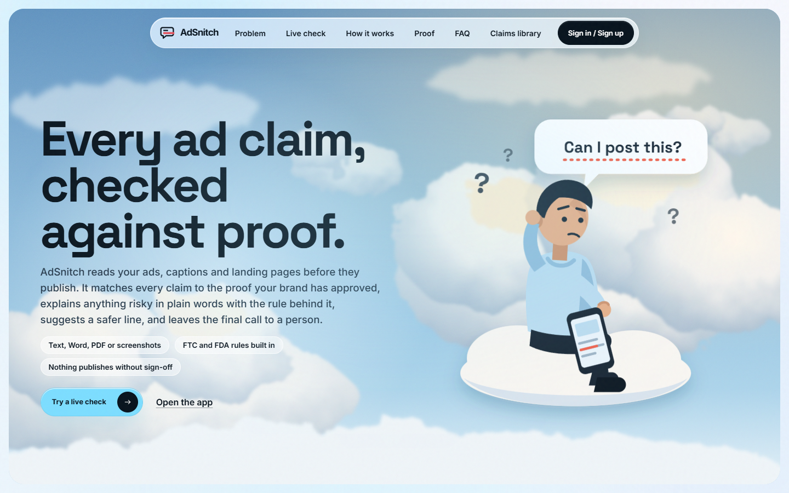
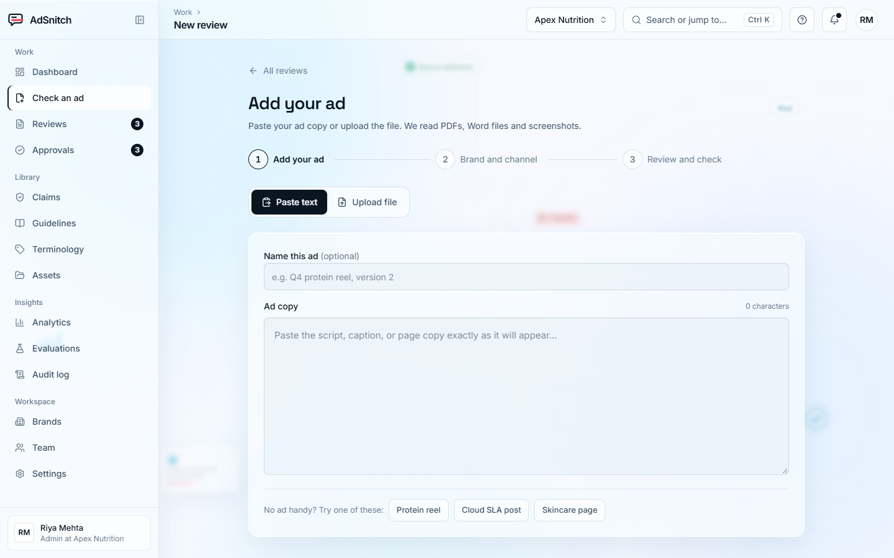
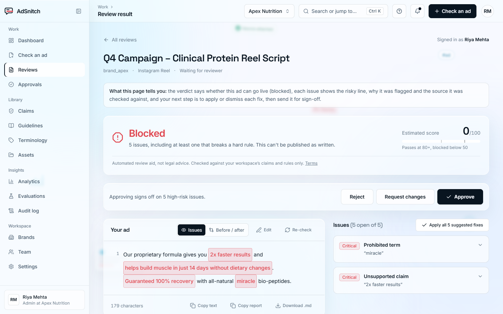
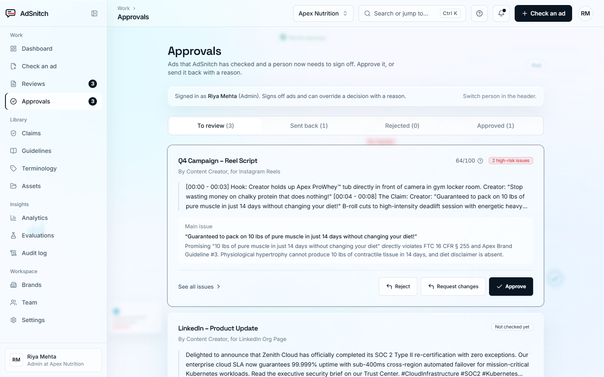
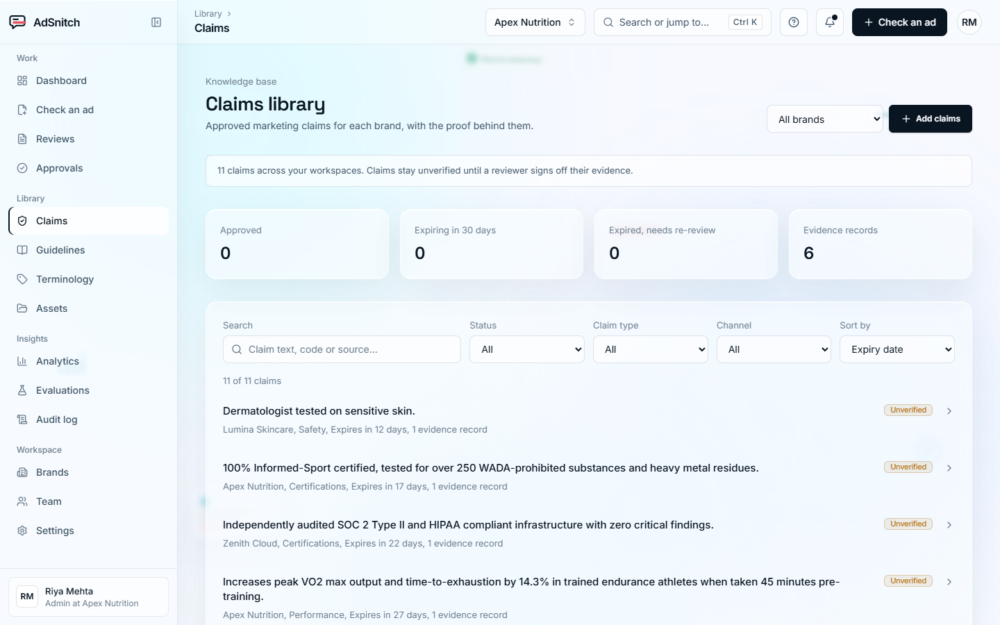
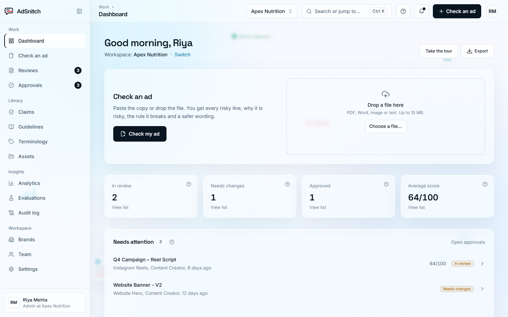
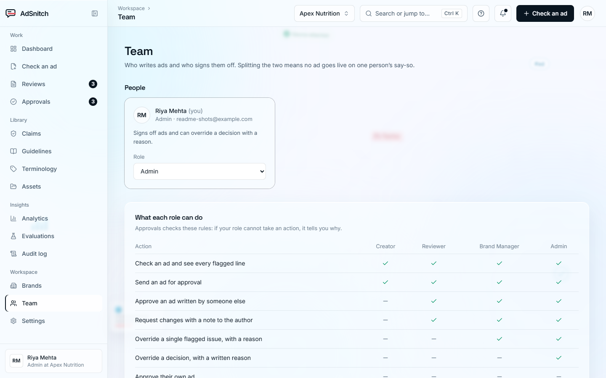

<p align="center">
  <picture>
    <source media="(prefers-color-scheme: dark)" srcset=".github/readme/logo-white.svg">
    
  </picture>
</p>

# AdSnitch

Checks your ad before the internet does.

> **Renamed:** this project was **Inkloom AI**. It is now **AdSnitch**. Same repo, same deployment.

**Live:** [inkloom-ai-tau.vercel.app](https://inkloom-ai-tau.vercel.app)



---

## The problem

Marketing teams publish claims every day: "2x faster results", "clinically proven", "trusted by 500 brands". Most of them are written fast, by people who don't know which ones need proof, and checked late, if at all. When a claim can't be backed up, the cost lands after it's public: regulator letters, platform takedowns, refunds, or a screenshot that won't go away.

- The **FTC fined Teami $1M (with a $15.2M judgment)** in 2020 for unsupported health claims and influencer posts with no `#ad`.
- **Adidas** emailed Boston Marathon finishers "Congrats, you survived" in 2017.
- **CNET** paused its AI-written finance articles in 2023 after factual errors in more than half of them.

Generic AI writing tools make this worse: they write convincing claims and invent sources. Legal review catches it, but it's slow, expensive and happens in email threads and spreadsheets.

## What AdSnitch does

AdSnitch sits between "draft done" and "publish". You paste or upload the ad. It finds every claim, checks each one against the proof your team has approved, flags anything missing a disclosure or using banned wording, and tells you plainly what's wrong and how to fix it. A person still makes the final call.

**The rule it never breaks:** a claim only counts as verified when it matches a record in your own claims library. AdSnitch never makes up a source.

---

## A check, step by step

### 1. Add your ad

Paste copy, or upload a PDF, Word file, image or screenshot. PDFs and images are read by AI, which keeps the actual copy and drops watermarks, page numbers and repeated headers or footers.



### 2. Get a verdict, line by line

Every risky phrase is highlighted in place. Each issue says what rule it breaks, why, what it was checked against, and a safer wording. One click applies a fix; the before/after view shows exactly what changed.



### 3. Send it for sign-off

Nothing publishes on one person's say-so. Reviewers approve, request changes with a note, or reject. Overrides need a written reason and are logged.



### 4. Keep the proof in one place

The claims library holds every approved claim with its source, excerpt, expiry date and owner. When a claim expires or changes, every draft that used it is flagged for re-review.



---

## What it checks

| Check | Example it catches |
|---|---|
| **Unsupported claims** | "2x faster results", "trusted by 500 brands", "#1 in India" with no approved record |
| **Banned wording** | "miracle", "cure", "risk-free", plus each brand's own blocked terms |
| **Missing disclosures** | Creator post with a promo code and no `#ad` (FTC 16 CFR 255); supplement claim with no FDA disclaimer (21 CFR 101.93) |
| **Expired or restricted claims** | A claim past its expiry date, or used on a channel it isn't approved for |
| **Channel fit** | A pitch deck or brochure submitted as an Instagram reel is rejected, not scored |
| **Tone** | Hype and insensitive phrasing ("killer deal", "you survived") |
| **Readability** | Sentences too long for the channel |

## How the score works

Every check runs through six stages:

1. **Segment** the copy and pull out candidate claims: numbers, guarantees, superlatives, comparisons, social proof.
2. **Rules** catch banned terms, missing required phrases, expired claims and wrong-channel content. These are deterministic and run in milliseconds.
3. **Retrieve** only the active brand's claims and guidelines. One brand's evidence is never used for another.
4. **Model review** (Gemini) audits each claim against that evidence. If the model is unavailable, a deterministic engine takes over so checks never stop.
5. **Safety net:** any claim that nobody commented on and no record covers is still flagged as unsupported.
6. **Score** from 0 to 100, with hard caps so the number always matches the verdict. Any critical issue caps the score at 40 and any high-risk issue at 75.

## For teams



- **Your own workspace.** Each company's ads, claims, people and notifications are kept separate.
- **Roles.** Creator, Reviewer, Brand manager and Admin, each with clear permissions. Nobody can approve their own ad.
- **Invites.** Admins invite teammates by email and pick their role.
- **Multiple brands.** Each brand gets its own claims library, guidelines and rules.
- **Audit log.** Every check, fix, approval and override is recorded with who did it and when.
- **First run.** New accounts set up their profile, then get a two-minute walkthrough they can skip.



---

## Built with

| Layer | Choice |
|---|---|
| App | Next.js 16 (App Router), React 19, TypeScript, Tailwind CSS 4 |
| Accounts, data, files | Supabase: Postgres with row-level security, Auth (email, Google, code-based password reset), Storage |
| AI | Gemini 2.5 Flash for claim review and document reading, with a deterministic fallback engine |
| Hosting | Vercel |

**Safety built in:** each organisation's data is isolated, saves use compare-and-swap so two people editing at once never overwrite each other, AI endpoints are rate-limited per user and per IP, and the server never trusts a user id sent from the browser.

## Repository layout

```
adsnitch/
├── src/
│   ├── app/                  pages and API routes (Next.js App Router)
│   │   ├── api/              check, extract, submissions, claims, approvals, team, profile
│   │   ├── auth/             sign in, sign up, password reset by email code
│   │   ├── welcome/          first-run profile setup
│   │   ├── dashboard/        home for signed-in users
│   │   ├── submissions/      new check, results, history
│   │   ├── approvals/        sign-off queue
│   │   ├── knowledge-base/   claims, guidelines, terminology, evidence files
│   │   └── terms, privacy/   legal pages
│   ├── components/           UI, landing page, layout, demo, result views
│   └── lib/
│       ├── ai/               pipeline, rules, retrieval, Gemini, file reading
│       ├── db/               per-organisation store
│       └── auth/             Supabase clients
├── supabase/migrations/      database schema, policies and functions
└── tests/                    end-to-end, brand isolation, feature tests
```

## Run it locally

```bash
npm install
cp .env.example .env.local   # then fill in the keys below
npm run dev
```

| Variable | Needed for |
|---|---|
| `NEXT_PUBLIC_SUPABASE_URL`, `NEXT_PUBLIC_SUPABASE_ANON_KEY` | Accounts and storage |
| `SUPABASE_SERVICE_ROLE_KEY` | Server-side data access |
| `GEMINI_API_KEY` | AI review and PDF/image reading (checks still run without it, using the rule engine) |

Apply the files in `supabase/migrations/` in order. The Supabase "Reset Password" email template must include `{{ .Token }}` so users get a 6-digit code.

## Tests

```bash
npm test        # pipeline, governance, brand isolation, file reading, channel fit
npm run eval    # benchmark against the evaluation dataset
```
